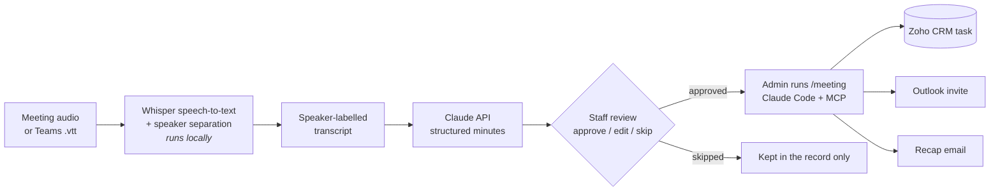

# AI Meeting Agent

**From a recorded staff meeting to approved CRM tasks, without anyone taking notes.**

Built for a small trade school's operations team. The agent records the meeting, tells the speakers apart,
writes the minutes, and turns every commitment into a proposed task with an owner and a due date. A person
approves each one before it becomes a Zoho CRM task, a calendar invite, or a recap email.


---

## The business problem

Staff meetings ran on personal notes. Everyone wrote down their own version, so:

- **Points were missed.** Each note covered what that person thought mattered.
- **Tasks had no clear owner or date.** "Can you send me the list by Thursday?" lived in one notebook.
- **Follow-up depended on memory.** Nothing reached the CRM, where the rest of the work is tracked.

The goal: one shared, accurate record of every meeting, and a short path from "we agreed to do X" to a
tracked task, without adding admin work.

## What it does

| Step | What happens | Where it runs |
|---|---|---|
| 1. **Record** | Record in the browser, or upload a Teams / Zoho Meeting recording or `.vtt` transcript | Browser |
| 2. **Transcribe** | Speech-to-text plus speaker separation ("who said what") | Locally, on the office Mac |
| 3. **AI minutes** | Summary, decisions, action items (owner, due date, quote), follow-up meetings, open questions, recap email | Claude API |
| 4. **Review** | Confirm speaker names; approve, edit or skip each item | Web page |
| 5. **Act** | Approved items become Zoho CRM tasks, Outlook invites and a recap email, then show as done with a link | Admin, via a [Claude Code skill](docs/claude-code-skill.md) |



## Key decisions, and why

- **Human approval before every write.** The AI proposes; a person decides. Wrong owners or invented tasks
  in a CRM are worse than no tasks, so nothing is created automatically.
- **Audio stays on the premises.** Meetings mention students by name. Transcription and speaker separation
  run on a local Mac (Whisper via MLX, pyannote segmentation + TitaNet embeddings via sherpa-onnx), and
  only the text transcript goes to the Claude API.
- **Structured output, not free text.** Claude returns a validated schema (Pydantic), so every action item
  has a task, owner, ISO due date, priority and the exact quote it came from. Relative dates ("by
  Thursday", "next Tuesday") are resolved against the meeting date.
- **Show the evidence.** Each task shows the quote and timestamp it came from; clicking ▶ plays that
  moment, so a reviewer can check a task in seconds.
- **Speaker names are confirmed, not assumed.** Speaker separation yields "Speaker 1, 2, 3". The AI
  guesses names from context and marks them with a **?** until someone confirms them.
- **Credentials stay out of the web app.** The page only records decisions. CRM and email writes go through
  an admin's existing, signed-in MCP connectors in Claude Code.

## Results so far

Measured on scripted test meetings (4 distinct **text-to-speech** voices, about 1.5 minutes each), on an
Apple M5 MacBook:

| | |
|---|---|
| End to end (upload → minutes ready) | **~43 s** for 90 s of audio |
| Speakers separated correctly | **4 of 4** synthetic voices (not yet proven on real people in a room; see below) |
| Due dates resolved correctly | **all** ("by Wednesday" → Nov 11, "next Tuesday" → Nov 17) |
| Cost of the AI minutes | **~$0.07 per meeting** (Claude Opus 5.5) |
| CRM write | Task created and read back in the live Zoho CRM |

Plus one real recording: a 3-minute Zoho Meeting with a single person in the room. There, speaker
separation **split one voice into two**, and Zoho's own transcript had no speaker labels at all. Claude
still wrote an accurate summary and correctly proposed **no tasks**, because nobody assigned any.

It hasn't run on a real staff meeting yet; the next step is a pilot with the team.

## Lessons from testing

- **Telling the clustering how many speakers there are made it worse.** Forcing 4 clusters merged two
  voices. The fix: let it find the voices itself and use the stated count only as a check that retries
  with a nudged threshold.
- **The AI must not "help" too much.** Early runs added an open question nobody asked, and a duplicate
  "put it on the calendar" task alongside the calendar invite itself. Explicit prompt rules fixed both.
- **Synthetic voices flatter speaker separation.** Four text-to-speech voices separated perfectly; one
  real person in a room was split into two "speakers". So task owners come from names people actually
  say ("Sam, can you…"), not from voice labels, and the reviewer assigns anything left unclear.
- **Check what existing automations do with your records.** A CRM rule closed every open task on a lead
  when the lead's status changed, which would have silently erased meeting tasks. The agent now warns
  before linking a task to a lead.

## Screenshots

| Home | Minutes | Phone |
|---|---|---|
|  |  |  |

## Run it

Needs an Apple Silicon Mac, Python 3.12, `ffmpeg`, and a Claude API key.

```bash
./setup.sh                                   # env + speaker models
# put ANTHROPIC_API_KEY in .env
.venv/bin/python app.py --config config.demo.json   # http://localhost:4610, opens the sample meeting
```

For your own organisation, copy `config.example.json` → `config.json` and `staff.example.json` →
`staff.json` (both git-ignored), then run `.venv/bin/python app.py`.

Command line, without the web page:

```bash
.venv/bin/python transcribe.py recording.m4a --title "Staff meeting" --speakers 4
.venv/bin/python minutes.py meetings/<date>_staff-meeting --names "Speaker 1=Maria Lopez,Speaker 2=Sam Carter"
```

The sample meeting in `examples/` is synthetic: a fictional school, fictional staff, and text-to-speech voices.

## Tech stack

Python · Flask · vanilla JS · MLX Whisper (large-v3-turbo) · sherpa-onnx (pyannote segmentation 3.0,
NVIDIA TitaNet speaker embeddings) · Anthropic Claude API (structured outputs) · Claude Code + MCP
(Zoho CRM, Microsoft 365) · ffmpeg

## What's next

- Host it so staff can use it without the admin's laptop: sign-in with the team's Zoho accounts, and
  approved tasks created directly through the Zoho API.
- Fetch Teams transcripts automatically after each meeting.
- Weekly "open tasks from meetings" digest per person.

---

Built by **Pratik Patil**, CRM & automation.
