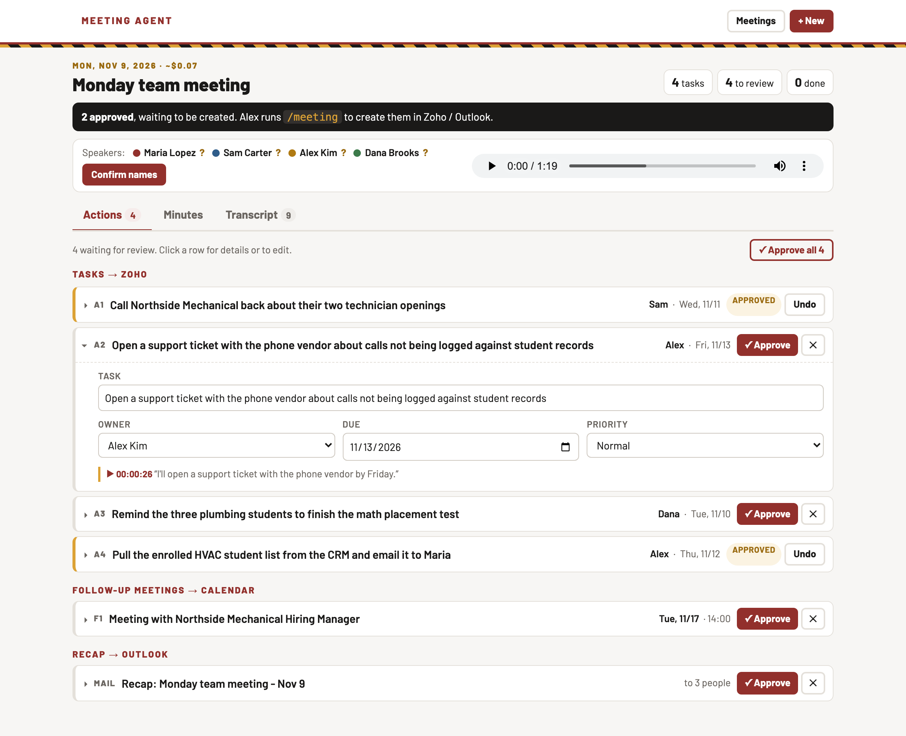
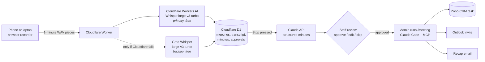
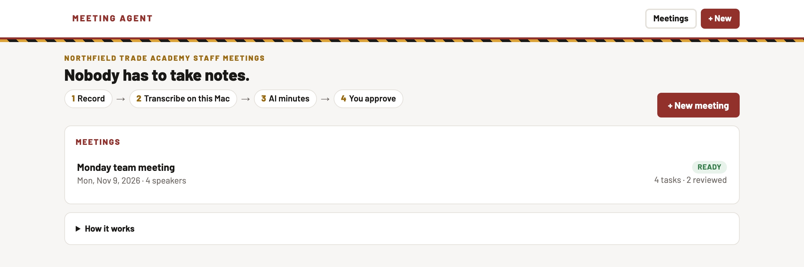
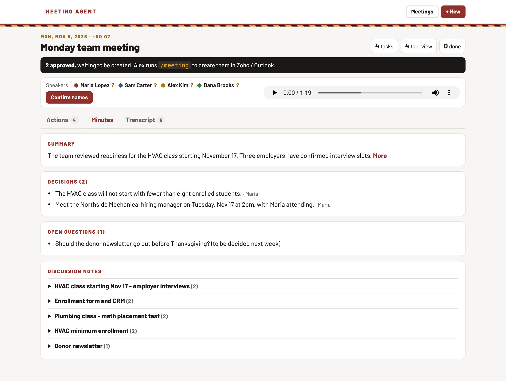
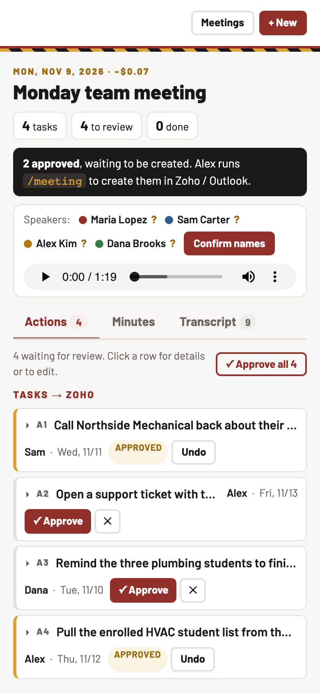

# AI Meeting Agent

**From a recorded staff meeting to approved CRM tasks, without anyone taking notes.**

Built for a small trade school's operations team. Anyone on the team opens a link on a phone or laptop
and taps Record. The agent transcribes the meeting as it happens, writes the minutes, and turns every
commitment into a proposed task with an owner and a due date. A person approves each one before it
becomes a Zoho CRM task, a calendar invite, or a recap email.

It runs in the cloud on free tiers. The only paid part is the AI that writes the minutes, about
**$0.03–0.20 per meeting**.



---

## The business problem

Staff meetings ran on personal notes. Everyone wrote down their own version, so:

- **Points were missed.** Each note covered what that person thought mattered.
- **Tasks had no clear owner or date.** "Can you send me the list by Thursday?" lived in one notebook.
- **Follow-up depended on memory.** Nothing reached the CRM, where the rest of the work is tracked.

The goal: one shared, accurate record of every meeting, and a short path from "we agreed to do X" to a
tracked task, without adding admin work or a new subscription.

## Architecture: hybrid, free-tier first



| Layer | Service | Why this one | Cost |
|---|---|---|---|
| Hosting + page | Cloudflare Workers | Always on, works with the admin's laptop closed, one link for any device | Free |
| Speech-to-text | Cloudflare Workers AI, Whisper large-v3-turbo | Accurate on accents and staff names when given a name prompt | Free (~3.5 h audio/day) |
| Backup speech-to-text | Groq, Whisper large-v3-turbo | Steps in automatically if Cloudflare fails on a piece, so no minute is lost | Free tier |
| Storage | Cloudflare D1 (SQLite) | Meetings, transcript pieces, minutes and approval state | Free |
| Minutes | Claude API (Opus 5.5) | Reliable structured output; refuses to invent owners or tasks | ~$0.03 per 5 min, ~$0.15 per hour |
| Actions | Claude Code + MCP connectors | CRM and email writes use the admin's signed-in connectors, so no credentials live in the web app | Existing licences |

**How a recording flows:** the page captures microphone audio at the device's native sample rate,
converts it to 16 kHz WAV itself, and uploads one piece every 60 seconds (retrying on bad Wi-Fi). Each
piece is transcribed while the meeting is still going, so minutes are ready about 15 seconds after Stop.
The Worker does almost no CPU work, which keeps it inside the free plan's limits.

## Key decisions, and why

- **Human approval before every write.** The AI proposes; a person decides. Wrong owners or invented tasks
  in a CRM are worse than no tasks, so nothing is created automatically.
- **One recorder, any platform.** In-person, Teams, Zoom or Zoho Meeting: put a phone in the room or
  open the page on the laptop running the call. No per-platform integration to maintain.
- **Owners come only from spoken names.** One microphone can't reliably tell voices apart, so the
  transcript has no speaker labels. Claude assigns a task only when a name is said ("Sam, can you…")
  and marks everything else *Unassigned* for the reviewer.
- **A second transcriber, not a second subscription.** Groq's free tier backs up Cloudflare. A weekly
  one-hour meeting uses under 5% of either free allowance.
- **Structured output, not free text.** Claude returns a validated schema (Zod / Pydantic), so every
  action item has a task, owner, ISO due date, priority and the exact quote it came from. Relative dates
  ("by Thursday", "next Tuesday") are resolved against the meeting date.
- **Org details are secrets, not code.** Staff names, the team code and API keys are deployment secrets.
  This public repo uses a fictional school.

### Options considered and rejected

| Option | Why not |
|---|---|
| Browser speech recognition (Web Speech API) | Free, but dropped names on accented speech (the name at the start of "…, you need to get it done today" was lost) |
| Whisper in the browser (transformers.js, WebGPU) | ~585 MB first download, slow on phones, repetition loops |
| Hugging Face / OpenRouter | No usable free speech-to-text tier |
| Gemini free tier | Its terms allow human review of inputs and advise against personal data; staff meetings name students |
| Paid transcription APIs | Not needed: free tiers cover the volume |
| Render free tier | Sleeps when idle, 512 MB memory, files wiped on restart |
| Zoho Meeting recordings | Recording is off by default; transcripts have no speaker labels; only covers online meetings |

## Results so far

| | |
|---|---|
| Transcription speed | ~3 s per 1-minute piece on Cloudflare, ~0.6 s on Groq |
| Minutes ready after Stop | ~15 s |
| Name accuracy | A test sentence naming three staff members and a batch code: every name correct on both engines with a names-only prompt (names withheld here) |
| Due dates | "by Friday" → Nov 13, "next Tuesday" → Nov 17, from a Tuesday Nov 10 meeting |
| Cost of the AI minutes | **$0.03** for a short test meeting |
| Invented tasks | **None**: Claude proposed no task for a request nobody agreed to |

It hasn't run on a real staff meeting yet; the next step is a pilot with the team.

## Lessons from testing

- **Don't force the phone's sample rate.** Asking iOS Safari for a 16 kHz audio context produced gibberish
  transcripts. Capturing at the native rate and downsampling in the page fixed it.
- **Shorter prompts beat longer ones on Groq.** Sending staff names plus a vocabulary list made Groq drop
  the first name in a sentence; a names-only prompt got every name right.
- **The AI must not "help" too much.** Early runs added an open question nobody asked, and a duplicate
  "put it on the calendar" task alongside the calendar invite itself. Explicit prompt rules fixed both.
- **Synthetic voices flatter speaker separation.** In the earlier local version, four text-to-speech voices
  separated perfectly, but one real person in a room was split into two "speakers". That's why owners now
  come from spoken names, not voice labels.
- **Check what existing automations do with your records.** A CRM rule closed every open task on a lead
  when the lead's status changed, which would have silently erased meeting tasks. The agent now warns
  before linking a task to a lead.
- **Phone sign-in has to forgive paste.** A password field hid typos and pasted extra text. A plain field
  that extracts the code from whatever is pasted, plus a one-tap sign-in link, fixed it.

## Screenshots

| Home | Minutes | Phone |
|---|---|---|
|  |  |  |

## Run it

### Cloud (recommended)

Needs a Cloudflare account, the [`cf` CLI](https://www.npmjs.com/package/cf), a Claude API key and,
optionally, a Groq API key.

```bash
cd cloud && npm install
cf auth login
cp .env.secrets.example.json .env.secrets.json   # fill in keys, team code and your staff list (git-ignored)
cf deploy --secrets-file .env.secrets.json
```

Staff then open `https://<your-worker>/#code=<team-code>` once; the code is remembered on that device.

**Name hints (optional).** Push the CRM's current leads, students and employers so the minutes spell them
exactly as the CRM does and don't merge first names said in a row into one person:
`PUT /api/hints` with `{ "people": [{ "name": "...", "note": "lead" | "<batch code>" }], "employers": ["..."] }`
(team-code header). The list lives only in the database, never in the repo.

### Local, on-premises (Apple Silicon Mac)

The first version runs everything except the minutes on a local Mac, including speaker separation:
MLX Whisper, plus pyannote segmentation and TitaNet embeddings via sherpa-onnx. Use it when audio
must not leave the building.

```bash
./setup.sh                                   # env + speaker models
# put ANTHROPIC_API_KEY in .env
.venv/bin/python app.py --config config.demo.json   # http://localhost:4610, opens the sample meeting
```

The sample meeting in `examples/` is synthetic: a fictional school, fictional staff, and text-to-speech voices.

## Tech stack

**Cloud:** TypeScript · Cloudflare Workers, Workers AI (Whisper large-v3-turbo) and D1 · Groq API · Vite ·
Anthropic Claude API (structured outputs, Zod) · vanilla JS + Web Audio

**Local:** Python · Flask · MLX Whisper · sherpa-onnx (pyannote segmentation 3.0, NVIDIA TitaNet) · ffmpeg

**Actions:** Claude Code + MCP (Zoho CRM, Microsoft 365)

## What's next

- Approved tasks created directly through the Zoho CRM API from the web page.
- Sign-in with the team's Zoho accounts instead of a shared code.
- Keep the audio for playback beside each task's quote.
- Weekly "open tasks from meetings" digest per person.

---

Built by **Pratik Patil**, CRM & automation.
